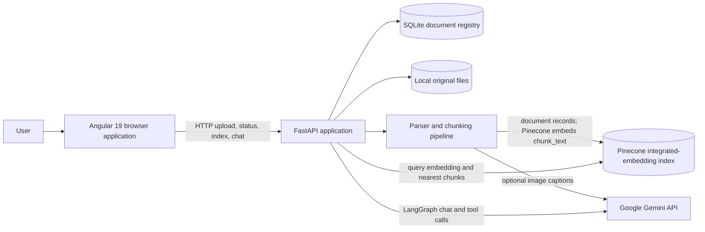
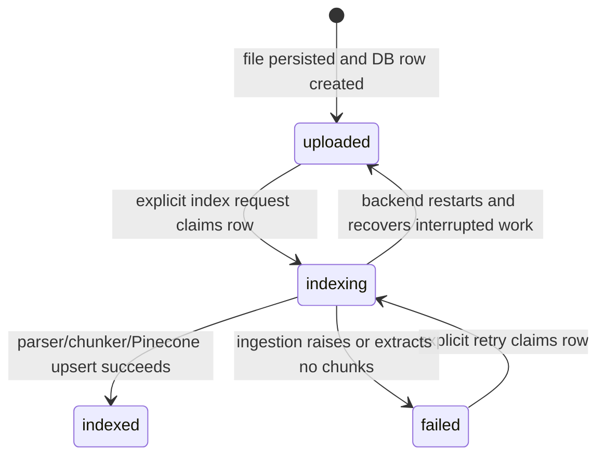

# Groundwork Architecture

This document describes the current implementation at both high-level design (HLD) and low-level design (LLD). It is maintained alongside the code; for setup commands see [readme.md](readme.md), for the repository map see [CONTEXT.md](CONTEXT.md), and for per-folder inventories see [backend/CONTEXT.md](backend/CONTEXT.md) and [frontend/CONTEXT.md](frontend/CONTEXT.md).

## 1. System purpose and scope

Groundwork is a local-first document question-answering application. Users upload documents through an Angular UI, explicitly trigger indexing, and ask questions in a chat interface. A FastAPI service stores original files and document processing state in SQLite, parses and chunks files, writes searchable chunks to Pinecone, and runs a Gemini-backed LangGraph agent with document-search and calculator tools.

The primary implemented formats are PDF, DOCX, TXT, Markdown, CSV, and JSON. ZIP files are accepted as containers of supported files. The system currently assumes one local application workspace and one Pinecone namespace; user authentication, tenant isolation, persistent chat history, and document deletion are outside the implemented scope.

## 2. HLD: system context

### 2.1 Component responsibilities

| Component | Responsibility | State or external dependency |
| --- | --- | --- |
| Angular UI | Chat, SSE consumption, multiple-file/ZIP selection, explicit indexing, paginated document metadata display, and status polling. | Browser memory; state is lost on refresh. |
| FastAPI API/orchestrator | HTTP routes, CORS, upload validation, file persistence, SQLite updates, background indexing, and SSE serialization. | Process-local compiled agent; local files and SQLite. |
| SQLite registry | Canonical record of each accepted file and its upload/index lifecycle. | `SQLITE_DB_PATH`; default `backend/data/rag_agent.sqlite3`. |
| Local upload store | Original document bytes used by the indexing worker. | `UPLOADS_DIR`; default `backend/data/uploads/`. |
| Parser/chunker | Selects PDF parser, extracts DOCX/text, captions selected PDF figures, and produces heading-aware chunks. | Local parser libraries/models; Gemini for optional captions. |
| Pinecone | Stores searchable chunks and uses its integrated embedding configuration for document and query vectors. | Configured index and namespace. |
| Gemini | Produces assistant responses/tool calls and optional PDF figure descriptions. | Google AI Studio key, model names, provider quotas. |
| LangGraph agent | Runs assistant/tool loop for chat. | Process-local graph constructed lazily on the first chat request. |

### 2.2 Deployment topology

During local development the Angular CLI serves the UI at `http://localhost:4200`, and Uvicorn serves FastAPI at `http://localhost:8000`. The frontend API base URL is currently hardcoded in `frontend/src/main.ts`. The browser talks directly to FastAPI; CORS permits origins listed in `CORS_ORIGINS` (default `http://localhost:4200`). The backend makes outbound requests to Pinecone and Google APIs. Docling OCR/layout processing runs locally and can download model assets on first use.

## 3. HLD: major data flows

### 3.1 Upload flow (persist only)

1. The user selects one or more supported files or a ZIP on the Documents page.
2. Angular sends a multipart request to `POST /api/documents/upload`, repeating the `files` field for each selected file.
3. FastAPI reads the upload, checks the extension, empty-file condition, and per-file byte limit. For ZIP, it validates the archive and expanded-entry limits, sanitizes each basename, and skips directories and unsupported entries.
4. Each accepted file is written to its own UUID directory under `UPLOADS_DIR`. Only after the write succeeds is its `uploaded` SQLite row created with content type, byte size, SHA-256, and UTC upload time.
5. The route returns successful rows and per-file rejection/errors. It does not call a parser or Pinecone.
6. Angular refreshes the SQLite-backed document list.

### 3.2 Index flow (explicit, asynchronous)

1. The user clicks **Index pending documents**; Angular calls `POST /api/documents/index`.
2. SQLite runs an immediate transaction and atomically claims every `uploaded` or `failed` row, changing status to `indexing` and recording `index_started_at`.
3. FastAPI schedules a background task and returns HTTP 202 with the queued count and IDs.
4. The task processes claimed files sequentially. Each file is parsed, chunked, and upserted into the configured Pinecone namespace. The DB row becomes `indexed` with parser, chunk/caption counts, and `indexed_at`, or `failed` with an error.
5. The UI polls `GET /api/documents` every 2.5 seconds while any record has `indexing` status.
6. At backend startup, records left in `indexing` are reset to `uploaded` so a later explicit indexing request can retry them.

### 3.3 Chat and retrieval flow

1. Angular sends `POST /api/chat` with a JSON message and accepts the response as an SSE stream.
2. FastAPI lazily builds the LangGraph agent if necessary and calls `astream_events`.
3. Gemini may answer directly or request one or more bound tools. The graph executes the search or calculator tool and returns tool output to the assistant for a final response.
4. A document search call embeds the query using the Pinecone integrated embedding model, retrieves up to four nearest `chunk_text` records, and returns source/page labels and passages to the agent.
5. FastAPI converts safe activity labels and generated text chunks to SSE events. Angular parses complete SSE frames and appends each token to the visible answer.

The UI can show operational activity labels such as `THINKING`, `SEARCHING`, and `CALCULATING`. It does not display private model chain-of-thought.

## 4. HLD: persistence boundaries and source of truth

- **SQLite is authoritative for upload and processing state.** It stores file metadata and local path, but original bytes live on disk.
- **Pinecone is authoritative for retrieval content.** It stores chunk text, source/parser/heading metadata, and vectors generated by the index's integrated embedding configuration.
- There is no distributed transaction spanning SQLite, local disk, Gemini, and Pinecone. The backend records each local upload before indexing; successful Pinecone writes are then reflected as indexed in SQLite.
- `document_id` is used as part of generated Pinecone record IDs to avoid collisions between separate uploads with the same filename.
- The SQLite list endpoint omits `stored_path`; the JSON metadata disclosure in the frontend displays only fields returned by the API.

## 5. LLD: backend package

### 5.1 `backend/app/main.py` - HTTP and orchestration

| Element | Design |
| --- | --- |
| App lifecycle | Lifespan initializes/migrates SQLite and recovers stale `indexing` rows before serving. |
| CORS | Configurable allowed origins; methods and headers are allowed broadly for the development UI. |
| Upload constants | 100 MiB per file or archive; maximum 500 non-directory ZIP entries; maximum 500 MiB declared expanded ZIP content. |
| `_safe_filename()` | Normalizes both slash styles, keeps only the basename, and replaces characters outside the allowed ASCII filename set. |
| `_save_uploaded_document()` | Validates suffix, byte size, and non-empty content; writes a UUID-isolated file; inserts SQLite metadata after write; removes the file if the insert/write path fails. |
| `_index_claimed_documents()` | Runs sequentially; invokes `ingest_file`; records `indexed` or `failed` for each document. Empty extraction is treated as failure. |
| `_sse_event()` | Encodes an event name and JSON payload into one SSE frame. |
| `ChatRequest` | Pydantic request body containing `message: str`. |

#### HTTP contract

| Method and path | Input | Result |
| --- | --- | --- |
| `GET /api/health` (also `/health`) | None | `{status, configured}`. `configured` checks that Google and Pinecone environment values are present, not that credentials have been remotely validated. |
| `GET /api/tools` | None | List of registered tool names and descriptions. |
| `GET /api/documents?limit=100&offset=0` | Optional pagination parameters; server clamps limit to 1-500 and offset to non-negative. | Global total/status counts plus one page of public metadata rows. |
| `POST /api/documents/upload` (also legacy `/api/upload`) | `multipart/form-data`, repeated `files` fields; a single `file` field is also accepted for compatibility. | `uploaded_count`, `rejected_count`, document records, per-file errors, and message. Successful upload status is `uploaded`. |
| `POST /api/documents/index` | None | HTTP 202 with queued IDs/count. It queues all `uploaded` and `failed` rows. No eligible rows produces a zero count. |
| `POST /api/chat` | JSON `{"message":"..."}` | `text/event-stream`, with `progress`, `token`, `done`, and `error` event types. |

Chat SSE payloads are JSON objects: `progress` carries `message`, `token` carries `text`, and `done`/`error` carry `message`. The stream uses no-cache and anti-proxy-buffering headers. Because chat uses POST and a JSON body, the browser reads the Fetch response stream instead of the browser `EventSource` API.

### 5.2 `backend/app/database.py` - SQLite registry

The database path is resolved from `SQLITE_DB_PATH`; relative paths resolve under `backend/`. A new SQLite connection is opened per operation, configured with row mappings, foreign keys, and a 30-second timeout. The database uses WAL mode. Context-manager exit commits successful work and rolls back exceptions.

#### `documents` table

| Column | Meaning |
| --- | --- |
| `id` | UUID primary key for the upload. |
| `filename` | Sanitized base filename. |
| `stored_path` | Absolute path to original bytes under the upload directory. Kept internal to backend responses. |
| `content_type` | Supplied or guessed MIME type; nullable. |
| `size_bytes` | Original byte size. |
| `sha256` | SHA-256 checksum of original bytes. |
| `status` | Constrained to `uploaded`, `indexing`, `indexed`, or `failed`. |
| `parser` | Selected parser label after successful indexing. |
| `chunk_count` | Number of Pinecone chunk records reported by ingestion. |
| `image_description_count` | Number of image caption chunks generated for the PDF. |
| `error` | Latest indexing error, truncated to 2,000 characters by the route. |
| `uploaded_at` | UTC ISO-8601 timestamp assigned when the upload row is created. |
| `index_started_at` | UTC ISO-8601 time of the latest claimed indexing attempt. |
| `indexed_at` | UTC ISO-8601 time of latest successful indexing. Cleared on retry claim. |
| `created_at`, `updated_at` | Row creation and latest state update timestamps. |

`initialize_database()` creates the schema and index for recent records. It migrates older schemas while preserving rows, translating old `uploading`/interrupted `indexing` statuses to `uploaded`; already indexed rows receive an indexed timestamp based on the legacy update time. `claim_documents_to_index()` uses `BEGIN IMMEDIATE` to prevent simultaneous requests from claiming the same pending records. `get_document_overview()` returns global counts and a paginated ordered list, adding `is_indexed` and omitting local paths.

### 5.3 `backend/app/knowledge.py` - parsing, chunking, indexing, search

#### File parsing and automatic PDF selection

| Input | Implementation |
| --- | --- |
| PDF | First parse with PyMuPDF4LLM to Markdown/page chunks and gather signals. Route to Docling when a table is detected or average extracted text is below 80 characters per page; otherwise use PyMuPDF4LLM output. |
| Complex/sparse/scanned PDF | Docling exports Markdown with OCR, table-structure, and heading-hierarchy options enabled. This work runs locally. |
| DOCX | `python-docx` extracts paragraphs, prefixes Word heading styles with Markdown heading markers, and serializes table rows as pipe-separated text. |
| TXT/Markdown/CSV/JSON | LangChain `TextLoader` with UTF-8 and encoding autodetection. |

PDF image captioning is an optional path (enabled by default). PyMuPDF enumerates embedded image placements, ignores duplicate xrefs, small images, and images covering more than 80% of the page, and attempts at most `PDF_MAX_IMAGES_PER_FILE` images (default 8). Selected image bytes are sent to Gemini using `PDF_VISION_MODEL`, falling back to `CHAT_MODEL`. Captioning errors are logged and do not discard extracted text/OCR. Full-page scan processing is left to the PDF OCR path; vector-only diagram content is not extracted by the raster-image caption pass.

#### Heading-aware chunking

`_heading_for_line()` recognizes Markdown heading markers and conservative standalone title-like lines. `_heading_sections()` maintains the active heading path and associates text with it. `_split_document()` groups sibling sections under a heading while the combined text fits `CHUNK_SIZE` (1,000 characters); a new top-level heading starts a new group, and oversized groups use `RecursiveCharacterTextSplitter` with `CHUNK_OVERLAP` (150 characters). If no heading is recognized, the original recursive splitter processes the entire document. Chunk metadata inherits parser/page/source fields and may include `title`, `heading_path`, `subtitles`, and `section_paths`.

#### Pinecone write and query

`ingest_file(path, filename, document_id)` dispatches by suffix, extracts source documents, adds filename metadata, splits into chunks, and builds Pinecone records with `chunk_text` plus normalized metadata. The record `_id` is a SHA-256 hash of upload ID (or filename fallback), chunk position, and chunk text. `batch_upsert()` targets `PINECONE_NAMESPACE`. Pinecone's integrated embedding model configured on `chunk_text` produces vectors; no local or Gemini embedding call is made.

`retrieve_context(query)` calls Pinecone document search with `EmbedQuery(field="chunk_text", query=query)`, retrieves `top_k=4`, and requests chunk text plus source/page/title/subtitle/parser metadata. The formatted result is given to the agent search tool. Search exceptions are converted to a readable tool result rather than being raised through the graph.

### 5.4 `backend/app/agent.py` - LangGraph agent

- `AgentState` stores a LangChain message list with the `add_messages` reducer.
- `search_knowledge_base(query)` delegates to `retrieve_context()`.
- `calculator(expression)` parses an expression in Python AST mode and recursively evaluates only numeric constants and explicitly allowed arithmetic operators. It does not evaluate arbitrary Python code.
- `TOOLS` registers the search and calculator tools.
- `SKILLS` currently contains grounded-answer/citation and concise-answer instructions; `build_agent()` combines these instructions into the Gemini system message.
- `build_agent()` creates `ChatGoogleGenerativeAI` with streaming enabled, binds tools, and compiles a graph with an assistant node, conditional tool routing, and a `ToolNode` loop back to the assistant.
- `main.py` constructs the compiled graph lazily on the first chat request and retains it in process memory.

### 5.5 Startup and dependency management

`backend/app/__main__.py` runs Uvicorn with reload on port 8000. `backend/pyproject.toml` declares dependency ranges; `backend/uv.lock` pins the resolved environment. `backend/.env.example` documents names/defaults for credentials, models, Pinecone, local SQLite/files, and CORS. `backend/.env` is local-only and ignored by Git.

## 6. LLD: frontend

### 6.1 Angular composition

The frontend is an Angular 19 standalone application bootstrapped from `frontend/src/main.ts`. It currently has one root `AppComponent`, inline templates, and no Angular Router or separate service layer. `CommonModule` supplies common directives/pipes and JSON display; `FormsModule` supports the chat composer. Styles and responsive layout are in `frontend/src/styles.css`. The API URL is currently hardcoded as `http://localhost:8000/api`.

The component maintains:

- `ChatMessage`: role, text, visible activity steps, current activity, and streaming state.
- `DocumentRecord`: one API record, including status and public metadata.
- `DocumentOverview`: global counts, status counts, and the current page of records.
- view state (`chat` or `documents`), selected `File` objects, pagination offset, upload/index flags, notice text, backend readiness, and an indexing poll timer.

### 6.2 Chat UI and SSE parser

`send()` posts JSON with `fetch()`, verifies the HTTP status, obtains a `ReadableStream` reader, decodes UTF-8 incrementally with `TextDecoder`, splits complete frames on blank lines, and retains a partial frame between reads. `parseSseFrame()` reads `event:` and `data:` lines, parses JSON payloads, appends progress labels or token text, and reports stream errors. The assistant bubble is updated as tokens arrive. Chat messages and displayed progress remain in browser memory only.

### 6.3 Document UI

The Documents view has a drag/drop and file-picker zone, selected-file list, upload action, separate index action, global total/indexed/not-indexed cards, and a paginated table. The accepted picker suffixes mirror backend support. The table shows filename/type/size, processing status and `is_indexed`, upload/start/success timestamps, parser/chunk/caption counts, errors, and a JSON metadata disclosure.

`uploadSelected()` posts each selected file under the repeated multipart key `files`, displays uploaded/rejected counts, clears the local selection, and refreshes records. `startIndexing()` triggers the index route and refreshes. `refreshDocuments()` requests the page with `limit=100` and current `offset`; while global `indexing` count is nonzero, `updatePolling()` starts a 2.5-second interval. Previous/next buttons adjust offset. The component clears the timer on destruction.

## 7. State machine and failure handling

- Upload errors are reported per file. Invalid/empty/oversized files are not registered as ready records. ZIP members that are unsupported are skipped and reported.
- Index failures persist an error on the row and leave it retryable. Index requests claim eligible rows atomically.
- A backend restart requeues rows in `indexing`; the user still triggers the next run from the UI/API.
- PDF caption failures do not fail the entire file; OCR or text extraction may still index it.
- Pinecone query errors are surfaced to the agent as the search tool's readable result.
- Chat stream errors use an SSE `error` event if the HTTP response has already started; configuration absence is returned as HTTP 503 before streaming.

## 8. Configuration and external contracts

| Setting | Default | Used by |
| --- | --- | --- |
| `GOOGLE_API_KEY` | unset | Gemini chat and, when enabled, PDF captions |
| `CHAT_MODEL` | `gemini-3.1-flash-lite` | LangChain Gemini chat and image caption fallback |
| `PDF_IMAGE_CAPTIONS` | `true` | Enable/disable embedded PDF figure captions |
| `PDF_VISION_MODEL` | `gemini-3.1-flash-lite` | Gemini caption model |
| `PDF_MAX_IMAGES_PER_FILE` | `8` | Per-PDF caption selection limit |
| `PINECONE_API_KEY` | unset | Pinecone Python SDK |
| `PINECONE_INDEX` | unset | Existing schema-based integrated-embedding index |
| `PINECONE_NAMESPACE` | `default` | Namespace for writes and searches |
| `SQLITE_DB_PATH` | `data/rag_agent.sqlite3` | SQLite registry file, relative to backend when not absolute |
| `UPLOADS_DIR` | `data/uploads` | Original-file root, relative to backend when not absolute |
| `CORS_ORIGINS` | `http://localhost:4200` | Comma-separated browser origins allowed by FastAPI |

Required Pinecone index contract: an integrated dense-embedding model is configured for string field `chunk_text`, and its model/schema is compatible with the document API's `batch_upsert` and `documents.search` calls.

## 9. Security, capacity, and known limitations

- There is no authentication or authorization. Anyone able to reach the API can upload files, index them, inspect document metadata, and query the shared collection.
- There is no per-user namespace or record filtering; all users of an instance would share the same Pinecone namespace and local document registry.
- A single file or archive is limited to 100 MiB, and ZIP expansion is limited to 500 entries/500 MiB. Multiple raw files in one multipart request do not currently have a total request-byte limit. ZIP processing reads the compressed archive into memory and then reads each accepted entry.
- Uploaded originals and the SQLite database are local persistent state. Back them up together; no retention or cleanup job is implemented.
- Document delete/replace endpoints and Pinecone vector deletion are not implemented. A parser change or changed re-indexed contents can leave old Pinecone records without a cleanup workflow.
- SQLite and Pinecone do not share a transaction. Process termination during upsert may leave partial vector writes; a retry reprocesses the document, but no reconciliation task compares Pinecone with SQLite.
- Background indexing is sequential and runs in FastAPI background tasks in the serving process. There is no durable task queue, multi-worker coordination beyond SQLite claim transactions, or indexing progress percentage.
- Chat history and SSE activity are not persisted. The activity labels are status updates and do not represent or expose the model's private reasoning.
- Retrieval currently returns four nearest chunks without reranking, score thresholding, or metadata filters. There is no standalone OCR/VLM for non-PDF images or image content not extractable as embedded raster objects.
- The configured Gemini free tier can impose quotas and rate limits; PDF caption requests can increase usage independently of chat.
- The health endpoint checks presence of required environment variables only; it does not test Pinecone/Gemini connectivity or billing/quota state.

## 10. Suggested next architecture steps

For a production or multi-user deployment, introduce authentication and tenant-scoped access, object storage, total request-size/rate limits, a durable job queue and worker, indexing idempotency/reconciliation and deletion, database migrations with a versioned migration tool, centralized logging/metrics, configurable frontend API base URL, and integration tests for upload/index/recovery/SSE flows.
